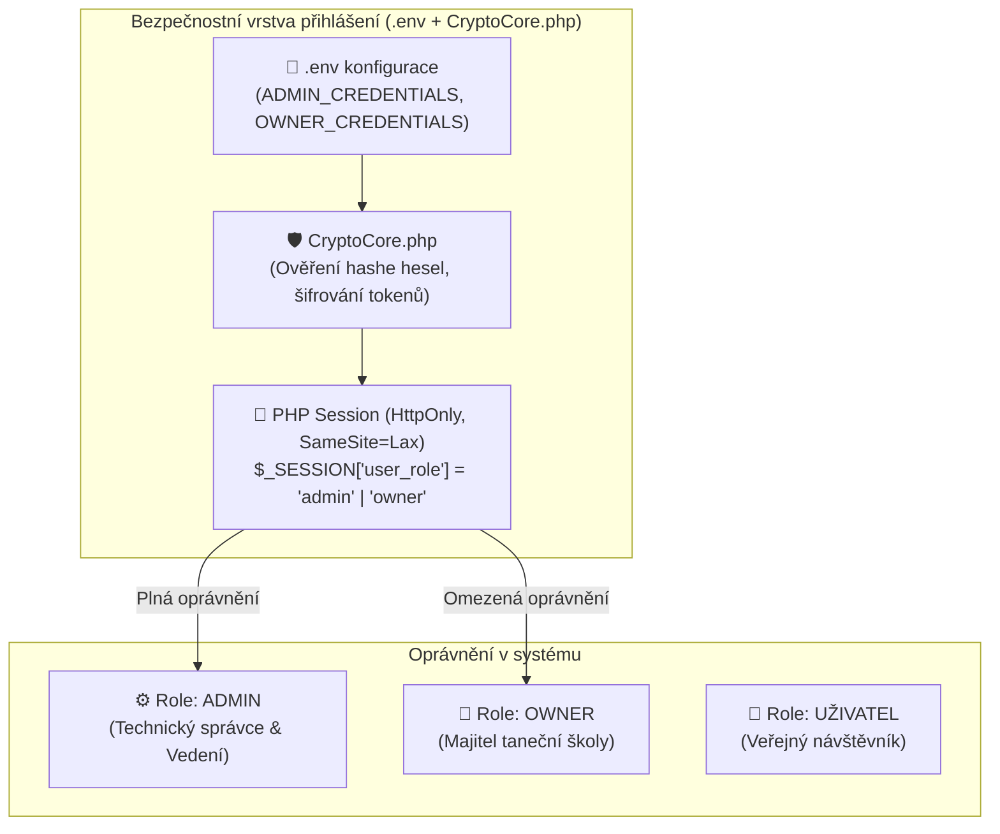
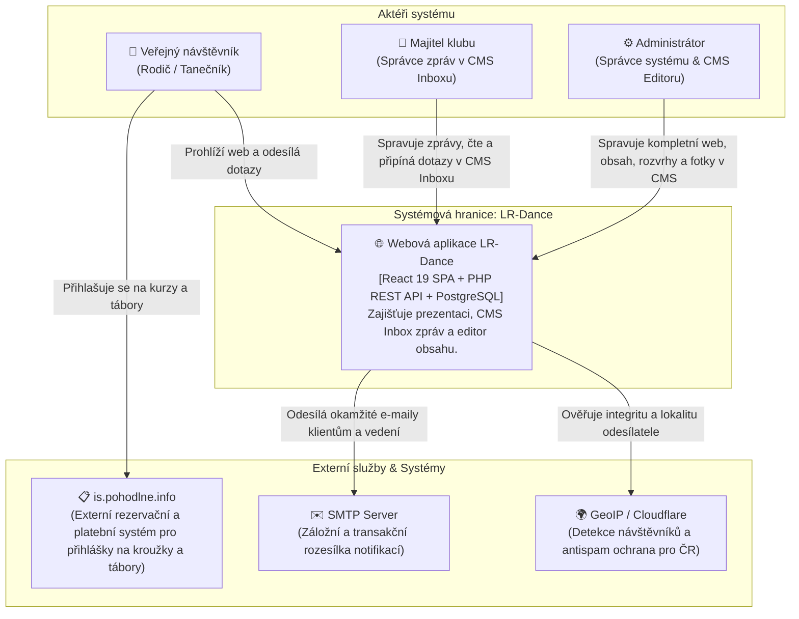
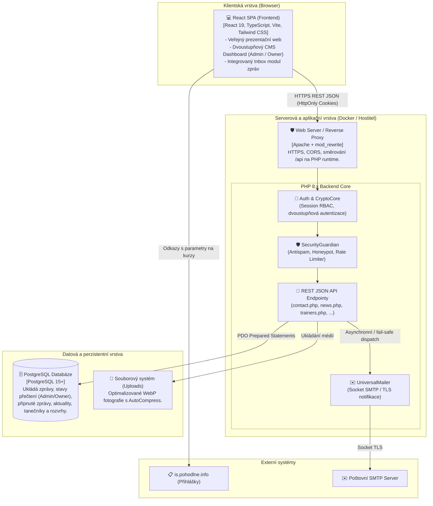
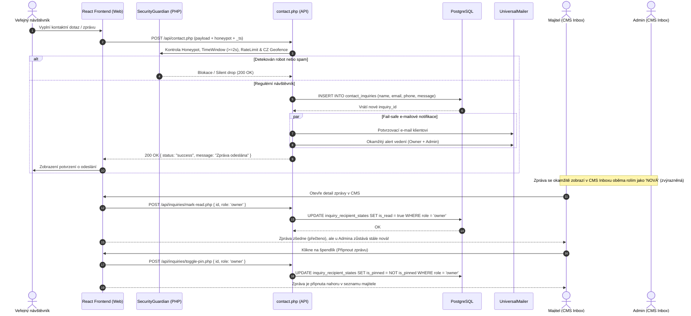
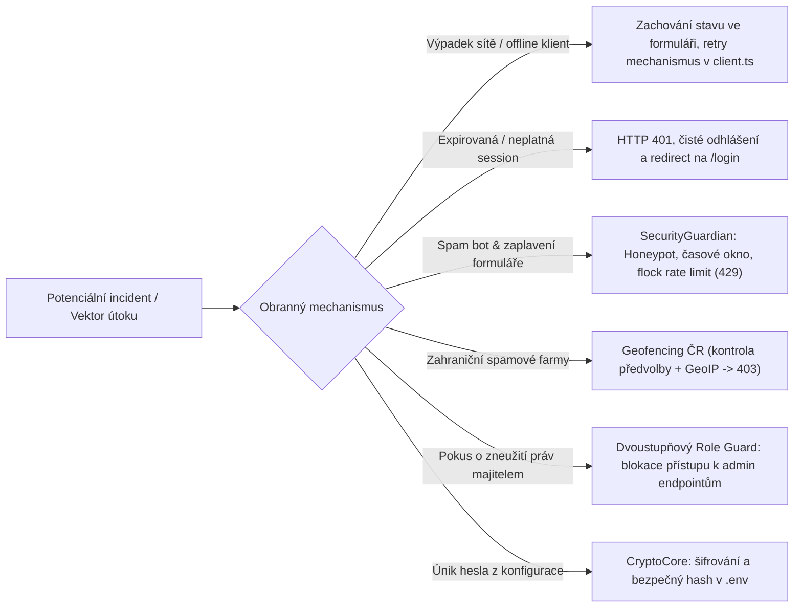
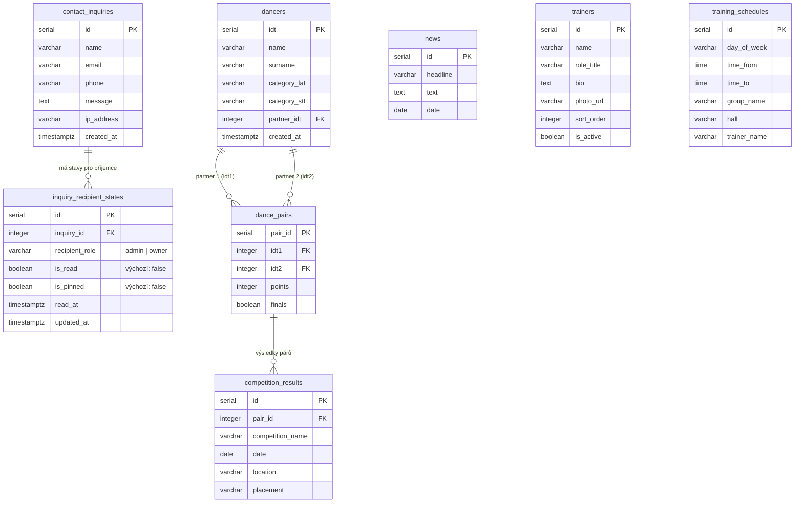

# Architektonická specifikace systému (SYSTEM_ARCHITECTURE.md)

**Projekt:** LR-Dance (Taneční klub LR DANCE TEAM Ostrava & Taneční škola CARMEN)  
**Verze:** 2.0.0 (Revize dle architektonického interview `/grill-me`)  
**Status:** Schváleno a závazné pro implementaci  
**Garant architektury:** Senior Software Architect (`system-architect`)

---

## 1. Úvod a kontext systému

Webová aplikace **LR-Dance** slouží jako oficiální digitální prezentace tanečního klubu LR DANCE TEAM Ostrava a partnerské taneční školy CARMEN. 

### 1.1 Klíčové poslání a vymezení rozsahu
- **Reprezentace klubu:** Prezentace tanečních párů, výsledků ze soutěží ČSTS, profilů trenérů, fotogalerie a historie.
- **Informační servis:** Publikace klubových aktualit, tréninkových harmonogramů a rozvrhů tanečních sálů.
- **Externí zápis a přihlášky:** Samotné formální přihlašování a evidence plateb na kurzy a tábory probíhá v dedikovaném externím informačním systému **`is.pohodlne.info`**. Web LR-Dance na něj odkazuje prostřednictvím přímých CTA tlačítek a deeplinků.
- **Komunikační hub & Integrovaný Inbox v CMS:** Návštěvníci mají k dispozici kontaktní a poptávkový formulář pro dotazy. V CMS je tento modul koncipován jako **integrovaná e-mailová schránka / inbox zpráv**, kde mají Majitel i Admin oddělené sledování stavů přečtení a možnost zprávy připínat (`pin`).

---

## 2. Klíčoví aktéři a dvoustupňový autorizační model (Two-Tier RBAC)

Autentizace nevyužívá těžkou databázovou tabulku uživatelů, ale **odlehčenou a bezpečnou správu v konfiguraci/environmentu**, kde jsou přihlašovací údaje (uživatelské jméno i heslo) kryptograficky chráněny pomocí komponenty **`CryptoCore.php`** (AES-256-GCM / Argon2id / bcrypt hašování).

### 2.1 Matice oprávnění

| Modul / Funkce | Uživatel (Veřejnost) | Majitel (`owner`) | Administrátor (`admin`) |
| :--- | :---: | :---: | :---: |
| **Veřejný web & Procházení sekcí** | ✅ Povoleno | ✅ Povoleno | ✅ Povoleno |
| **Přesměrování na `is.pohodlne.info`** | ✅ Povoleno | ✅ Povoleno | ✅ Povoleno |
| **Odeslání zprávy / dotazu z webu** | ✅ Povoleno | ✅ Povoleno | ✅ Povoleno |
| **CMS Inbox: Čtení zpráv a dotazů** | ❌ Zakázáno | ✅ Povoleno | ✅ Povoleno |
| **CMS Inbox: Vlastní stav viděno / přečteno** | ❌ Zakázáno | ✅ Nezávislý stav | ✅ Nezávislý stav |
| **CMS Inbox: Připnutí zprávy (PIN)** | ❌ Zakázáno | ✅ Vlastní PIN | ✅ Vlastní PIN |
| **CMS: Správa aktualit a článků** | ❌ Zakázáno | ❌ Zakázáno | ✅ Povoleno |
| **CMS: Správa trenérů a rozvrhů sálů** | ❌ Zakázáno | ❌ Zakázáno | ✅ Povoleno |
| **CMS: Nahrávání fotografií a galerie** | ❌ Zakázáno | ❌ Zakázáno | ✅ Povoleno |
| **Konfigurace systému a správa `.env`** | ❌ Zakázáno | ❌ Zakázáno | ✅ Povoleno |

---

## 3. Integrace třetích stran a interních modulů

1. **Externí systém přihlášek (`is.pohodlne.info`):**
   - Oficiální klientská databáze kurzů, členů a plateb. Web LR-Dance integruje dynamické směrování (CTA tlačítka s parametry konkrétních kurzů).

2. **Integrovaný CMS & Editor obsahu (Dashboard):**
   - Plně naroubovaný na stávající designový systém `LR_Web_FE` (Tailwind CSS, jednotná typografie, panelové karty).
   - Čerpá mechanismy z `dev-library` (kompaktní formuláře, drag & drop, tabulkové náhledy, instantní inline editace bez zbytečných závislostí).
   - Implementuje dvoustupňový strážce na frontendu (`RoleGuard` / `ProtectedRoute`) i backendu (`requireRole('admin' | 'owner')`).

3. **Transakční Mailer (`UniversalMailer.php`) – Fail-Safe Hybridní model:**
   - **Databáze je primární pravda:** Zpráva z kontaktního formuláře se v prvním kroku uloží do PostgreSQL. Pokud selže SMTP server nebo síť, data se neztratí a zobrazí se v CMS Inboxu.
   - **Obousměrné notifikace:**
     - Klient obdrží okamžité automatické potvrzení o doručení zprávy.
     - Vedení klubu (Admin i Owner) obdrží okamžitý e-mailový alert s obsahem zprávy.
   - **Volitelný týdenní digest:** Podpora pro souhrnný týdenní e-mail přes odlehčený cron skript.

---

## 4. C4 Kontextový diagram (C4 Context Diagram)

---

## 5. C4 Kontejnerový diagram (C4 Container Diagram)

---

## 6. Datový tok mezi React frontendem a backendem

Komunikace je centralizována v `LR_Web_FE/src/api/client.ts` přes funkci `apiFetch<T>()` s automatickým posíláním cookie přihlášení (`credentials: 'include'`).

### 6.1 Životní cyklus zprávy: Od odeslání po CMS Inbox (Sekvenční diagram)

---

## 7. Bezpečnostní model a Misuse Cases (Risk Matrix)

### 7.1 Detailní mitigace Misuse Cases

1. **Selhání sítě (Network Failure / Offline stav):**
   - **Chování:** Pokud při odesílání dotazu selže spojení (např. mobilní internet návštěvníka), `apiFetch` zachytí síťovou výjimku.
   - **Řešení:** React komponenta formuláře **nesmaže vyplněná data**, zobrazí uživateli zřetelnou notifikaci s tlačítkem „Zkusit odeslat znovu“.

2. **Expirovaný nebo neplatný token / session:**
   - **Chování:** Majitel nebo administrátor opustí prohlížeč a pokusí se o akci po vypršení platnosti session (`cookie_lifetime = 3600s`).
   - **Řešení:** Backendový kontrolor `requireAuth()` okamžitě vrací `401 Unauthorized`. Frontendový `client.ts` zachytí 401 a `ProtectedRoute` automaticky provede bezpečné přesměrování na `/login` bez poškození stavu aplikace.

3. **Pokus o spam a formulářový flooding:**
   - **Chování:** Skript se pokouší hromadně zahltit inbox stovkami zpráv.
   - **Řešení:**
     1. *Honeypot:* Pole `website` / `_hp` neviditelná pro lidi – pokud jsou vyplněna, backend vrátí tichý úspěch (silent drop).
     2. *Časové razítko:* Odeslání formuláře pod 2 sekundy od vygenerování stránky je odmítnuto kódem `422`.
     3. *Rate Limiting:* Souborově zamykaný rate limiter (`SecurityGuardian::checkRateLimit`) s limitem max. 5 požadavků za 10 minut na IP adresu.

4. **Přístup k nepovoleným funkcím majitelem (Privilege Escalation):**
   - **Chování:** Majitel se pokusí přímo zavolat API pro úpravu trenérů, fotek nebo systémových souborů.
   - **Řešení:** Každý citlivý endpoint má strážce `requireRole('admin')`. Pokud je v session nastavena hodnota `owner`, backend vrátí `403 Forbidden` a zapíše bezpečnostní log.

---

## 8. Databázová architektura a relace (PostgreSQL)

Pro podporu oddělených stavů čtení a připínání zpráv pro Majitele i Administrátora je navržena čistá relační struktura:

### 8.1 Popis klíčových tabulek Inboxu a Web CMS

#### 1. `contact_inquiries` (Přijaté dotazy a zprávy)
- `id` (SERIAL, PK): Identifikátor zprávy.
- `name` (VARCHAR(150)): Jméno a příjmení odesílatele.
- `email` (VARCHAR(255)): Kontaktní e-mail.
- `phone` (VARCHAR(50)): Telefonní číslo pro případný kontakt.
- `message` (TEXT): Znění zprávy z formuláře.
- `ip_address` (VARCHAR(45)): IP adresa pro audit a geofencing.
- `created_at` (TIMESTAMPTZ, default `NOW()`): Čas doručení.
- *Indexy:* `idx_contact_inquiries_created_at` (B-Tree sestupně).

#### 2. `inquiry_recipient_states` (Stav zprávy pro Admina a Majitele)
Umožňuje nezávislé stavy „viděno“ a „připnuto“ pro obě role bez ovlivnění druhého uživatele.
- `id` (SERIAL, PK): Identifikátor stavu.
- `inquiry_id` (INTEGER, FK -> `contact_inquiries.id` ON DELETE CASCADE).
- `recipient_role` (VARCHAR(20)): Identifikátor role (`'admin'` nebo `'owner'`).
- `is_read` (BOOLEAN, default `false`): Zda uživatel dané role zprávu otevřel (po otevření zešedne).
- `is_pinned` (BOOLEAN, default `false`): Příznak připnutí zprávy na vrchol seznamu.
- `read_at` (TIMESTAMPTZ, nullable): Čas prvního přečtení.
- `updated_at` (TIMESTAMPTZ, default `NOW()`): Čas poslední změny stavu.
- *Unikátní index:* `UNIQUE(inquiry_id, recipient_role)`.

#### 3. `trainers`, `training_schedules`, `news`
- Tabulky spravované výhradně rolí `admin` v CMS pro zajištění aktuálních informací o trenérském týmu, týdenních trénincích sálů a klubových novinkách.

---

## 9. Technologický stack a provozní parametry

| Komponenta | Technologie | Verze / Poznámka |
| :--- | :--- | :--- |
| **Frontend** | React 19 + TypeScript 5.8+ | Bundlováno přes Vite 8, SPA routing přes React Router 7 |
| **Design systém** | Tailwind CSS + Lucide Icons | Karty, modální okna, indikátory novinek (badge, špendlík) |
| **Backend Runtime** | PHP 8.2+ | Nativní moduly PDO PostgreSQL, OpenSSL, GD/WebP |
| **Databáze** | PostgreSQL 15+ | Běží v Docker kontejneru s perzistentním volume `pgdata` |
| **Šifrování & Bezpečnost** | `CryptoCore.php` + `SecurityGuardian.php` | AES-256-GCM, atomický flock rate limit, antispam CZ |
| **E-mail Subsystem** | `UniversalMailer.php` | Přímé Socket SMTP spojení s TLS autentizací |
| **Externí Integrace** | `is.pohodlne.info` | Rezervační a členský systém (přesměrování z CTA tlačítek) |

---

## 10. Kontrolní checklist a akceptační kritéria

- [x] Ověřeno, že přihlašování na kurzy je delegováno na `is.pohodlne.info`.
- [x] Implementován model **CMS Inbox** s oddělenými thready stavů pro Admina a Majitele (čtení/připínání).
- [x] Přihlašovací údaje spravovány v `.env` s kryptografickým ověřením přes `CryptoCore.php`.
- [x] Fail-safe hybridní model pro Mailer – primární perzistence v PostgreSQL, transakční e-mail jako notifikace.
- [x] Všechny Mermaid diagramy validovány a otestovány pro zobrazení v GitHub/Markdown prohlížeči.
